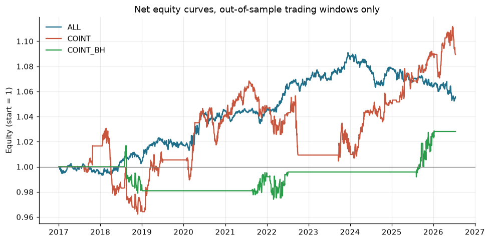
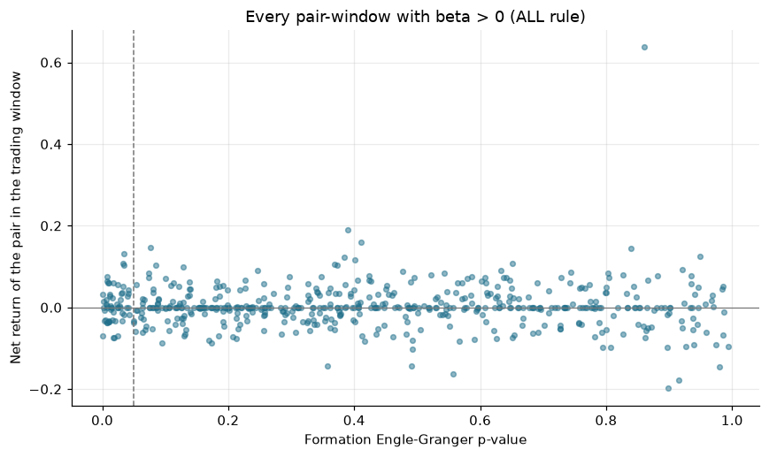

# Pairs trading walk-forward study

I tested whether Engle-Granger cointegration measured in a two-year formation window predicts profitable mean reversion in the next six-month trading window. The universe is 30 economically matched US large-cap pairs, 19 walk-forward windows, with illustrative trading costs.

## Headline result

The primary variant is COINT (net of costs), fixed in advance in `PREREGISTRATION.md`.

- Net annualized return: 0.91%
- Net annualized Sharpe ratio: 0.32 (indicative 95% interval from a block bootstrap: -0.36 to 0.99)
- Max drawdown: -6.63%

In this sample the answer to the research question is no: the strategy made a small net profit, the Sharpe interval includes zero, the formation p-value shows no rank relationship with out-of-sample return, and the variant that ignores cointegration (ALL) has a higher net Sharpe ratio.





## Results (net of costs)

Sharpe ratios are excess-return Sharpe ratios with no risk-free subtraction. The long-short return is treated as an excess return and no cash yield is added.

| Variant | Net ann. return | Net ann. volatility | Net Sharpe | Max drawdown | Pair-windows traded | Completed trades |
|---|---|---|---|---|---|---|
| ALL | 0.57% | 1.50% | 0.39 | -3.55% | 547 | 440 |
| COINT | 0.91% | 2.94% | 0.32 | -6.63% | 57 | 63 |
| COINT_BH | 0.29% | 1.92% | 0.16 | -4.22% | 12 | 12 |

The full analysis, including gross numbers, exit reasons, market beta, and sensitivity tables, is in `2_Walkforward_Analysis.ipynb`.

### Filling one day later

The main results fill each trade at the close where the signal appears, which is an idealization. I ran the study again with each trade filled one day later. For COINT, the net Sharpe ratio goes from 0.32 (bootstrap interval -0.36 to 0.99) to 0.10 (interval -0.54 to 0.71), and the net annualized return goes from 0.91% to 0.24%. The answer to the research question does not change: the strategy still makes a small net profit, and both Sharpe intervals include zero. The numbers are in `results/execution_lag_sensitivity.csv`. This check is not in `PREREGISTRATION.md`. I added it after a review, and it does not replace the primary result.

## Method

- Windows: two years (504 trading days) of formation, then six months (126 trading days) of trading, rolled forward by 126 days. This gives 19 windows from 2015 to 2026. The last partial window is dropped.
- Frozen parameters: in each formation window I fit `log(Y) = alpha + beta * log(X) + e` by OLS and record sigma, the Engle-Granger p-value, and the half-life. These stay frozen for the whole trading window.
- Signals: the z-score of the spread enters at 2.0 in absolute value, exits at 0, and stops at 4.0. After a stop there is no re-entry in that window. Everything is closed on the last day of the window.
- Lag: the position held on day t is the state decided at the close of day t-1.
- Costs: 5 bps one way per unit of gross notional traded, and a 0.50% annual borrow fee on the short leg. Both are illustrative assumptions.
- Variants: ALL trades every pair with beta above 0. COINT also needs an Engle-Granger p-value below 0.05 and a half-life between 1 and 63 days. COINT_BH replaces the raw p-value rule with Benjamini-Hochberg at a false discovery rate of 0.10 across all pairs tested in that window.
- Portfolio: capital is split equally across the pairs that are eligible in a window. A flat pair contributes zero. A window with no eligible pair returns zero.

## Pre-registration

All parameters, the 30 pairs, the trading rules, the three variants, and the primary metric are written in `PREREGISTRATION.md`. I wrote it before downloading any data and I did not change any parameter after seeing results. The entry threshold and cost grids in the sensitivity tables are checks on that fixed setting, not a search for a better one.

## Tests

`tests/test_pairs.py` has 17 tests with fixed seeds. They cover: no look-ahead in positions, the fill lag, isolation of the formation fit from trading prices, the sign of the short leg, trade costs, the stop rule, the forced close at window end, no same-day close and open, recovery of a known hedge ratio and half-life on synthetic data, the false rejection rate of the cointegration test on independent random walks, window layout, Benjamini-Hochberg, and the metric formulas. Run them with:

```
pytest
```

`check_consistency.py` checks that every number in the headline and results table above matches `results/summary.csv` and `results/bootstrap.csv`, and that every file named in this README exists.

## Limitations

- The universe is today's survivors, and I chose the pairs with hindsight about which firms are similar. The direction of the resulting bias is not known.
- Signals are computed at the close and filled at the same close. This is an idealization. See "Filling one day later" above.
- There is no bid-ask spread or slippage model.
- The 5 bps cost and the 0.50% borrow fee are illustrative assumptions. See the cost sensitivity table in the analysis notebook.
- Constant-weight daily rebalancing between entry and exit is not costed.
- Engle-Granger has limited power in a two-year window and depends on which ticker is the dependent variable.
- All pairs share one 2015 to 2026 market history, so the pairs are not independent.
- Thirty pairs is a small sample.

## File layout

- `README.md`: this file.
- `PREREGISTRATION.md`: the fixed design, written before any data was downloaded.
- `LICENSE`: MIT license.
- `.gitignore`: files kept out of version control.
- `requirements.txt`: pinned package versions.
- `config.py`: every constant, plus the pair list.
- `pairs.py`: the library (windows, fits, signals, returns, costs, metrics, bootstrap).
- `download_data.py`: downloads prices into the cache (only with `--refresh` when the cache exists).
- `run_walkforward.py`: runs the full study and writes the results files.
- `check_consistency.py`: checks the README numbers and paths against the results.
- `1_VMA_Case_Study.ipynb`: V/MA case study notebook.
- `2_Walkforward_Analysis.ipynb`: analysis of the full study.
- `tests/test_pairs.py`: unit tests.
- `data/prices.csv`: cached adjusted close prices.
- `data/metadata.json`: download timestamp, library version, tickers, dropped pairs.
- `results/pair_windows.csv`: one row per pair and window.
- `results/trades.csv`: one row per completed trade.
- `results/portfolio_returns.csv`: daily net portfolio returns for the three variants, plus SPY.
- `results/summary.csv`: gross and net metrics for each variant.
- `results/cost_sensitivity.csv`: net Sharpe and return across cost levels.
- `results/entry_sensitivity.csv`: net Sharpe and return across entry thresholds.
- `results/execution_lag_sensitivity.csv`: net Sharpe, return, drawdown and Sharpe interval with the fill at the signal close and one day later.
- `results/bootstrap.csv`: bootstrap estimates and intervals from the analysis notebook.
- `results/vma_case_study_windows.csv`: V/MA per-window table written by the case study notebook.
- `Images/equity_curves.png`: net equity curves.
- `Images/pairs_passing_per_window.png`: pairs passing the cointegration test per window.
- `Images/pvalue_vs_return.png`: formation p-value against out-of-sample return.
- `Images/vma_in_distribution.png`: where V/MA falls among the 30 pairs.
- `Images/vma_zscore_window0.png`: V/MA z-score in the first trading window.

## How to run from a fresh clone

```
python3 -m venv .venv
source .venv/bin/activate
pip install -r requirements.txt
pytest
python run_walkforward.py
jupyter nbconvert --to notebook --execute --inplace 1_VMA_Case_Study.ipynb
jupyter nbconvert --to notebook --execute --inplace 2_Walkforward_Analysis.ipynb
python check_consistency.py
```

Tested with Python 3.12.5 on macOS.

The cached prices in `data/prices.csv` are included, so results reproduce exactly. `python download_data.py --refresh` downloads fresh prices, which will change the results. `run_walkforward.py` compares V/MA against `results/vma_case_study_windows.csv`, which is committed.

## References

- Engle, R. F. and Granger, C. W. J. (1987). "Co-Integration and Error Correction: Representation, Estimation, and Testing."
- Gatev, E., Goetzmann, W. N. and Rouwenhorst, K. G. (2006). "Pairs Trading: Performance of a Relative-Value Arbitrage Rule."

## What's next

- A point-in-time universe that includes delisted names.
- Rolling (Kalman) hedge ratios.
- The Johansen test.
- Intraday execution modeling.

## Data source

Prices come from the yfinance library, which `download_data.py` calls with `auto_adjust=True`, and the study uses the adjusted `Close` series. The request covers 2015-01-01 up to but not including 2026-11-01, and the saved file runs from 2015-01-02 to 2026-10-30 (2975 trading days). The tickers are SPY as the benchmark plus the 60 tickers of the 30 pairs listed in `config.py`, which `PREREGISTRATION.md` fixed before any data was downloaded. All 61 tickers downloaded and no pair was dropped. The prices are saved to `data/prices.csv`, and the download details to `data/metadata.json`.
